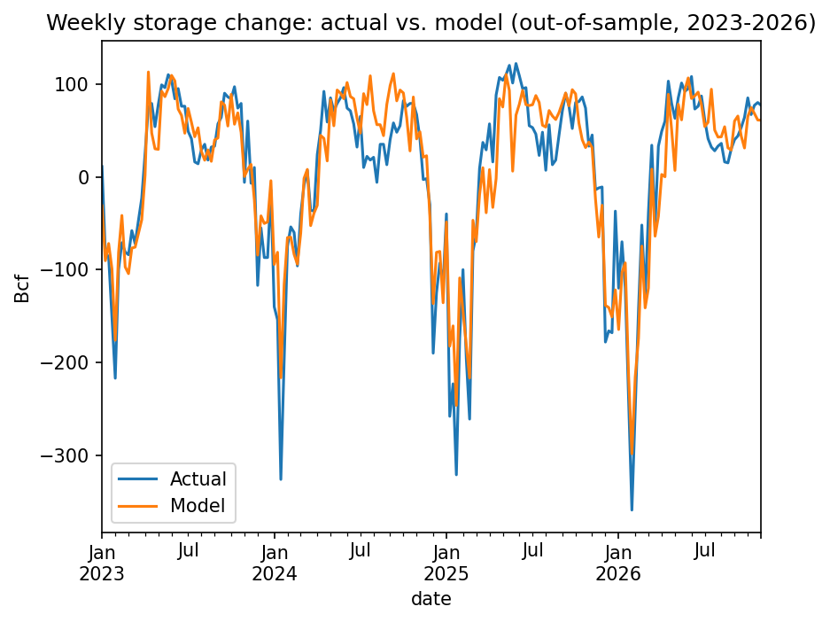

# Weekly U.S. Natural Gas Storage Forecast

Forecasts the weekly change in Lower 48 working gas storage that the EIA reports every Thursday, using heating and cooling degree days.

## Results (out-of-sample, Jan 2023 to Oct 2026, 200 weeks)

| Model | Mean absolute error |
|---|---|
| Naive: same week last year | 40.3 Bcf |
| 8-city weather regression | 28.7 Bcf |

The weather model cuts error by 29% versus the naive benchmark.

## Data
- EIA Weekly Lower 48 Working Gas in Underground Storage, Jan 2010 to Oct 30, 2026 ([source](https://www.eia.gov/dnav/ng/hist/nw2_epg0_swo_r48_bcfw.htm))
- Open-Meteo historical daily mean temperature ([source](https://open-meteo.com/en/docs/historical-weather-api))

## Method
1. Weekly storage change = this week's storage minus last week's
2. Daily HDD = max(65°F minus mean temp, 0); CDD = max(mean temp minus 65°F, 0)
3. HDD averaged across Chicago, Detroit, Minneapolis, New York, Philadelphia and Boston; CDD across Houston and Dallas
4. Daily values summed into Friday-ending weeks to match the EIA report week
5. OLS regression: weekly_change ~ HDD + CDD
6. Trained on 2010 to 2022 (678 weeks), tested on 2023 to Oct 2026 (200 weeks)

## Limitations
- Weather only: underpredicts the largest withdrawals, when extreme cold also cuts production (e.g., Winter Storm Fern, January 2026)
- No supply-side data (production, LNG feedgas, Mexico exports)
- Cities are equal-weighted, not population-weighted
- One regression across 2010 to 2026 ignores market growth since 2016

## Next steps
- Add a time trend or post-2016 term
- Add dry gas production and LNG feedgas
- Population-weight degree days

## How to run
Open `natgas_storage_model.ipynb` in Google Colab, upload the EIA storage history as `storage.csv` (date and storage columns, header rows removed), then run all cells.

## Tools
Python, pandas, statsmodels, Google Colab
